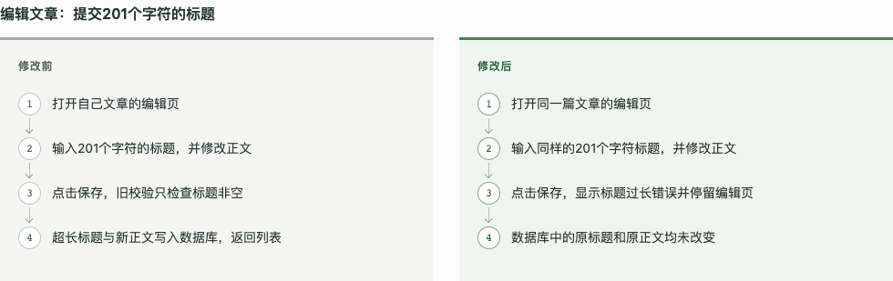

# 2026-10-26：从可用核心推进到可重复执行的任务流程

结论：当前工作区已经具备真实 Web、后端和 CLI 项目的完整任务交付能力。新执行器把配置完成后的运行、报告、封存和讲解串起来；结构索引减少手写定位数据；实际发现的恢复、清理、索引和摘要问题已修复并复验。仍处于本地开发候选状态，包版本保持 0.4.0，尚未发布这些更新。

“能用”有以下实测支持；“好用”还要看使用者是否看得懂交付、首次接入成本和更多技术栈的稳定性。用户本轮明确反馈纯文字不够直观，需要前后对比图，已据此增加行为流程对比。尚无对完成图示的真人理解验证，不能把代理审阅当作用户认可。

## 全新项目任务：原 0.4.0 基线

Skill 固定于 commit `470a2c48550faca8906628eac604290ee9442686`。三个独立代理在隔离副本中执行真实上游项目任务；不是仅对本仓库的受控样例测试。

| 项目与任务 | 最终实际执行 | 首次任务总耗时 / 命令数 | 最终状态 |
| --- | --- | --- | --- |
| TodoMVC：确认后清空全部，取消保留，刷新仍生效 | 6 条浏览器测试，48 个动作/断言步骤 | 19 分 26 秒 / 60 | PASSED，原生证据与基线齐全 |
| Flask tutorial：创建/编辑标题最多 200 字，错误不写入 | 40 条 pytest + 2 条真实 Chrome 流程 | 17 分 33 秒 / 73 | PASSED，封存且源码当前 |
| Click complex：新增 hello 与 --shout，保留原命令 | 8 条真实子进程测试，7 个场景 | 7 分 26 秒 / 38 | PASSED，证据与讲解齐全 |

三次用户介入为 0；每次都有协调者固定 Skill 版本的指导，CLI 还有 1 次范围澄清（实际上游不存在 hello）。因此不能写成“完全零指导”。依赖安装、环境处理和失败修复包含在首次耗时中；没有测 token 成本。固定 commit、提示及重复方法见 [评测案例](../../tests/evals/README.md)。

发现的真实问题包括：TodoMVC 原始内存存储不满足刷新要求、按钮被装饰层遮挡、Flask 测试错误假设旧重定向状态码，以及 CLI 原生用例 ID 映射。首次失败未被覆盖；修正测试假设有当前上游代码依据，产品缺陷按原需求修复。

原始记录：[Web](2026-10-26/baseline-web.json)、[后端](2026-10-26/baseline-backend.json)、[CLI](2026-10-26/baseline-cli.json)。

## 当前候选在已接入项目上的复验

这是复制已完成配置、需求、测试和基线的项目后复验；不包含首次业务理解，不能据此宣称比上表提速多少倍。

- `execute` 运行真实测试并自动生成 `SUMMARY.md`、报告、封存和任务详情。最终 Web 6/6、后端 40+2、CLI 8 条测试继续通过。每批候选固定在独立目录并记录文件哈希，不混用修改中的脚本。
- `resume` 复用完成回执；正常完成运行的命令、日志和原生证据 hash/mtime 不变。源码变化、证据损坏或命令被中断且无结束回执时拒绝盲目重跑。
- `index` 支持 Python AST 与可选 TypeScript 解析器，按任务源码目录定位，默认排除测试/打包产物。保留已有业务说明；未解析调用明确列出，不能当作业务覆盖。
- 摘要从方法噪声中分离真实改动、关联影响和未知：后端改动条目 43→2；Web 84→8。已解决偏差与未验证范围分开，未映射文件明确标为讲解缺口。
- 真实复验发现并修复 getter/setter 合并覆盖、服务主进程退出后遗留忽略 SIGTERM 的子进程。复用相同最小探针确认 getter/setter 行号、参数、ID 独立，原始索引不被合并修改；自有服务进程全部退出。
- 复核当前调用链用途，修正 Web 旧说明中“尚无界面入口”的过时表述；不改需求或测试断言。

记录：[执行与故障](2026-10-26/executor-cli.json)、[故障再现](2026-10-26/candidate-cli.json)、[进程清理修复复验](2026-10-26/service-cleanup.json)、[后端重复执行](2026-10-26/candidate-backend.json)、[后端验收边界](2026-10-26/backend-boundaries.json)、[Web 最终复验](2026-10-26/final-web.json)、[访问器索引](2026-10-26/accessor-check.json)。

可直接阅读的交付样例：[后端摘要](2026-10-26/backend-summary.md)、[Web 摘要](2026-10-26/web-summary.md)。这些摘要保留当时原文；任务详情中的行为对比图是在用户反馈后另行补充的展示，不改写原测试证据。

## 根据用户反馈补上的前后对比图

同一个“输入201字符标题并保存”的操作，左侧展示原来会写入，右侧展示现在提示错误且原文章不变。先看用户可观察的变化，再展开方法、代码和证据；没有基线依据时保留未知。

[桌面整页](2026-10-26/comparison-desktop.png) / [手机页面](2026-10-26/comparison-mobile.png)。Chrome 实测 1280×800 首屏能完整看到两侧四步；390 像素宽纵排无横向溢出，方法展开和代码跳转可用。原 49 个输入与验收证据文件 hash 不变，原验收保持 current/PASSED；图示本身仍是 agent-authored、verified=false，不产生新测试通过结论。依据见 [基线与断言核对](2026-10-26/comparison-basis.json) 和 [布局实测](2026-10-26/comparison-check.json)。

## 工具与安装包回归

| 检查 | 结果 |
| --- | --- |
| Python 回归 | 190 项通过 |
| Node 回归 | 26 项通过 |
| 任务页与关系图交互 | 10 项通过，包含前后对比图及手机布局 |
| 原生 reporter 契约 | 5 项通过 |
| 实际浏览器故障分类 | 9 种预期结果正确；包含4条故意失败的原生测试 |
| Python CLI + TypeScript 索引 | 通过，包含构造器、getter/setter、范围、遮蔽和稳定合并 |
| Skill 格式校验 | 通过 |
| 实际打包与安装 | 29 个包文件；已安装资源与当前源码逐字节匹配 |
| 已安装执行器运行真实 CLI | 7 个场景通过；resume 后22个证据/回执文件内容和mtime不变 |

详细日志、候选文件哈希及测试分类见 [verification.json](2026-10-26/verification.json)，安装包完整性与执行记录见 [package-smoke.json](2026-10-26/package-smoke.json)。没有发布 npm 包或推送远端。

发布前补充复验：本机完整回归发现进程清理的信号发送或存活探测偶发返回 `PermissionError`，原实现会中断执行记录和报告生成。现已保留该错误为清理未确认，生成待验收报告且不封存通过；新增真实运行器回归覆盖信号拒绝和探测拒绝。修复后 Python 191 项通过，原进程组清理用例连续 20 次通过，Node 26 项通过。上述历史日志和候选哈希保留原样，不代表这次补充修复后的源码快照。

## 从同类工具学习了什么

以下依据 2026-10-26 官方文档，是职责对照和本项目的设计选择；没有对其他工具执行同条件性能测试。

| 参考 | 官方能力重点 | 本项目采用的方式 |
| --- | --- | --- |
| [OpenSpec](https://github.com/Fission-AI/OpenSpec) | 规格、场景、实现计划及变更归档 | 复用需求来源；用实际执行证据核对任务，符合既定政策后收尾 |
| [GitNexus](https://github.com/abhigyanpatwari/GitNexus) | 符号、调用和依赖图，影响分析 | 增加轻量结构索引、来源和未知标记；复杂跨模块解析仍可借助外部图谱 |
| [Superpowers](https://github.com/obra/superpowers) | 规划、测试、评审与分阶段实施工作流 | 将任务与独立行为评测贯穿交付；减少要求用户手工串辅助步骤的负担 |
| [Playwright Trace Viewer](https://playwright.dev/docs/trace-viewer) | 查看实际测试的操作、页面快照和调试记录 | 沿用原生报告与 trace，和需求、源码版本、中文行为讲解关联 |

Project Check 的当前定位是“把这次需求、实际改动、用户看得懂的前后对比和版本绑定验收放在一起”。它的轻量索引不是 GitNexus 完整代码分析的替代品，也没有替代测试框架或规格库。

## 尚未证明的范围

- 真人能否根据最终对比图准确复述修改与边界，尚待反馈；没有统计用户满意率或学习效果。
- 三个项目都是小型公开样例。大型私有项目、复杂多服务与生产数据、其他技术栈尚未由本轮验证。
- 托管运行目前适配 pytest JUnit 和 Playwright JSON；自定义运行器仍走已有手动导入流程。
- 静态索引支持 Python、JS/TS 的部分结构；跨模块、动态分派及其他语言保留未知，业务含义仍需实际阅读。
- 托管服务进程组清理限 macOS/Linux；Windows 使用已有测试框架管理服务。本机掉电或执行器被强杀后的自动清理不在保证内。
- 测试源码哈希只能绑定审阅版本，不能证明断言覆盖所有业务。任务通过始终不等于整个项目已验收。

原始记录副本的来源、大小与 SHA-256 见 [evidence-index.json](2026-10-26/evidence-index.json)。包含的临时绝对路径仅用于追溯当日隔离运行；原生 trace 等大体积证据保留在对应隔离项目中。
